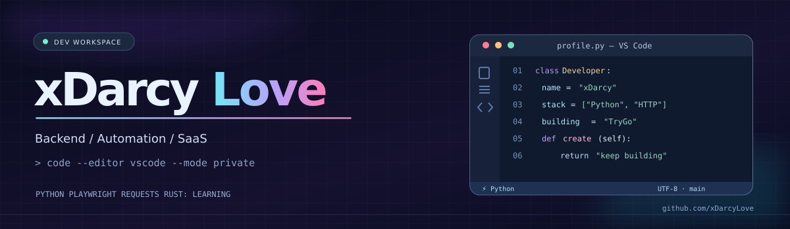
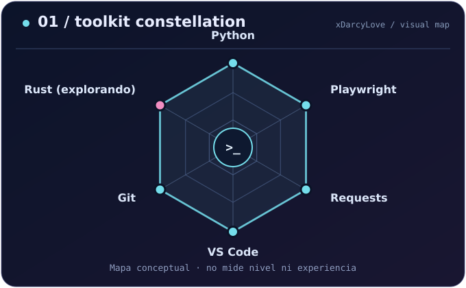

<div align="center">



<br />

<a href="https://github.com/xDarcyLove"></a>


<br /><br />

**`Build quietly. Learn constantly. Ship thoughtfully.`**

*Python · Automation · HTTP integrations · Backend · SaaS*

</div>

---

## `$ whoami`

```console
xDarcyLove@vscode:~$ whoami
xDarcy  •  Developer / Builder

xDarcyLove@vscode:~$ cat mission.txt
Construyo herramientas que resuelven problemas reales.
Me gusta explorar cómo funcionan los sistemas,
automatizar procesos y aprender construyendo.
```

¡Hola! Soy **xDarcy** 👋. Trabajo principalmente con **Python** en scripts, automatización de navegador y consumo de servicios HTTP. Desarrollo y pruebo mis ideas en **Visual Studio Code**. Me interesan las **APIs**, la arquitectura backend, la seguridad y los productos SaaS. Estoy explorando **Rust**, todavía en etapa de aprendizaje.

> 🔐 **Private by design:** gran parte de mi trabajo vive en repositorios privados. Aquí comparto mis áreas de trabajo y aprendizajes, no código confidencial ni datos personales.

---

## `$ cat tech-stack.yaml`

```yaml
identity:
  alias: xDarcy
  github: "@xDarcyLove"
  workspace: "Visual Studio Code"

languages:
  active:
    - Python
  learning:
    - Rust

tooling:
  browser_automation:
    - Playwright
  http_clients:
    - Requests
  version_control:
    - Git
    - GitHub

interests:
  - Backend architecture
  - HTTP APIs & integrations
  - Automation & reliability
  - Security & privacy
  - SaaS products

projects:
  visibility: private
  main_focus: TryGo
```

<div align="center">
  
  <br />
  <sub>Mi caja de herramientas actual · Rust es una tecnología que sigo explorando</sub>
</div>

---

## `$ ./map --toolkit --focus`

<table>
<tr>
<td width="50%"></td>
<td width="50%"></td>
</tr>
</table>

<sub>Gráficos originales inspirados en la presentación visual de perfiles de desarrollo. Son **mapas conceptuales**, no puntuaciones de dominio, años de experiencia ni métricas de productividad.</sub>

---

## `$ ls -la ~/projects/private/`

<table>
<tr>
<td width="33%" valign="top">
<h3>🚚 TryGo</h3>
<code>SaaS / Logística</code><br /><br />
Producto orientado a empresas de reparto. Incluye trabajo en gestión administrativa, roles, sedes, suscripciones y cobros.<br /><br />
<sub>Próximo enfoque: gestión operativa de envíos y entregas.</sub>
</td>
<td width="33%" valign="top">
<h3>⚙️ Automation Lab</h3>
<code>Python / Playwright</code><br /><br />
Prototipos de automatización web y herramientas de consola para pruebas, flujos repetitivos y procesamiento de resultados.<br /><br />
<sub>Enfoque: validación, estabilidad y uso responsable.</sub>
</td>
<td width="34%" valign="top">
<h3>🔌 Data Integrations</h3>
<code>Python / Requests / HTTP</code><br /><br />
Experimentos de integración con información empresarial (RUC) y tipos de cambio publicados por SUNAT.<br /><br />
<sub>Enfoque: formatos, errores y manejo seguro de datos.</sub>
</td>
</tr>
</table>

<details>
<summary><b>🔎 ¿Por qué no hay enlaces a esos proyectos?</b></summary>
<br />
Los repositorios son privados. Sus descripciones son generales; no implican que todas las funcionalidades previstas ya estén publicadas o terminadas. No comparto credenciales, datos personales ni código interno en este perfil.
</details>

---

## `$ code --status`

```diff
+ Construyendo software con Python y VS Code
+ Mejorando integraciones HTTP y manejo de errores
+ Diseñando y evolucionando flujos de TryGo
~ Estudiando Rust y arquitectura backend
~ Profundizando en seguridad y buenas prácticas
```

## `$ cat dev-philosophy.py`

```python
def approach(problem):
    understand(problem)
    prototype(language="Python", editor="VS Code")
    validate_results()
    improve_reliability()
    return "keep building"
```

---

## `$ connect --socials`

<div align="center">
  <a href="https://github.com/xDarcyLove"></a>
  <br /><br />
  <sub>Less noise. More learning. Better systems.</sub><br />
  <sub>Made with ☕ and too many VS Code tabs — <b>xDarcy</b></sub>
</div>
