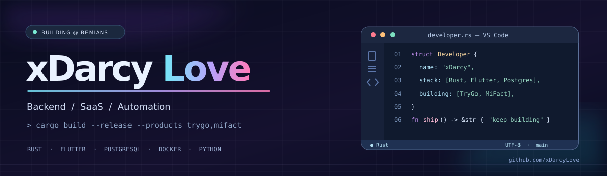
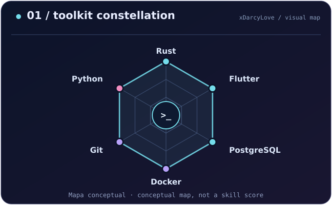
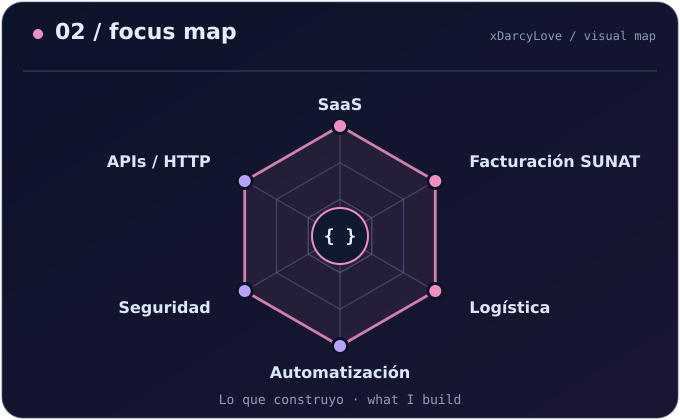

<div align="center">



<br />


<br /><br />

**`Build quietly. Learn constantly. Ship thoughtfully.`**

*Rust · Flutter · PostgreSQL · SaaS · Automation*

</div>

> **EN —** I build SaaS products for Peruvian businesses at **Bemians**: **TryGo** (logistics and deliveries) and
> **MiFact** (SUNAT electronic invoicing). Rust backends, Flutter apps and PostgreSQL with row-level security, shipped
> in containers. Python for automation and integrations. My repositories are private by design.

---

## `$ whoami`

```console
xDarcyLove@bemians:~$ whoami
xDarcy  •  Builder @ Bemians

xDarcyLove@bemians:~$ cat mission.txt
Construyo software que resuelve problemas reales de empresas peruanas:
productos completos, seguros y fáciles de usar, de la base de datos a la pantalla.
```

¡Hola! Soy **xDarcy** 👋. En **Bemians** construyo productos SaaS para empresas del Perú. El backend lo escribo en
**Rust**, las aplicaciones web y móviles en **Flutter**, y los datos viven en **PostgreSQL** con seguridad por fila
para que cada empresa vea solo lo suyo. Despliego en contenedores y uso **Python** para automatizaciones e
integraciones. Me importan la arquitectura backend, la seguridad, las APIs y los detalles que hacen que un producto
se sienta bien.

> 🔐 **Private by design:** mi trabajo vive en repositorios privados. Aquí comparto qué construyo y cómo, no código
> confidencial ni datos personales.

---

## `$ cat tech-stack.yaml`

```yaml
identity:
  alias: xDarcy
  github: "@xDarcyLove"
  company: Bemians

stack:
  backend: Rust            # axum, sqlx, tokio
  apps: Flutter / Dart     # web y Android
  database: PostgreSQL     # row-level security, migraciones versionadas
  automation: Python       # Playwright, Requests

infrastructure:
  - Docker
  - nginx
  - Railway
  - Cloudflare R2

interests:
  - SaaS products
  - Backend architecture
  - HTTP APIs & integrations
  - Security & privacy
  - Electronic invoicing (SUNAT)

projects:
  visibility: private
  products: [TryGo, MiFact]
```

<div align="center">
  
  <br />
  <sub>Las herramientas con las que construyo mis productos · The tools I build with</sub>
</div>

---

## `$ ./map --toolkit --focus`

<table>
<tr>
<td width="50%"></td>
<td width="50%"></td>
</tr>
</table>

<sub>Mapas conceptuales, no puntuaciones de dominio ni años de experiencia · Conceptual maps, not skill scores.</sub>

---

## `$ ls -la ~/bemians/`

**Bemians** es la empresa detrás de mis productos: software para que las empresas peruanas operen y cumplan con
SUNAT sin complicarse. *Bemians builds software that helps Peruvian businesses run and stay SUNAT-compliant.*

<table>
<tr>
<td width="50%" valign="top">
<h3>🚚 TryGo</h3>
<code>SaaS · Logística</code><br /><br />
Plataforma para empresas de reparto: paquetería, rutas y entregas, apps para el equipo en campo, cobros,
suscripciones y comprobantes electrónicos.<br /><br />
<sub><b>Rust · Flutter · PostgreSQL</b> — <i>logistics and delivery management.</i></sub>
</td>
<td width="50%" valign="top">
<h3>🧾 MiFact</h3>
<code>SaaS · Facturación electrónica</code><br /><br />
Facturación electrónica SUNAT para empresas: facturas, boletas, notas, guías de remisión, retenciones y
percepciones, con API pública, PDF en el servidor y multiempresa con seguridad por fila.<br /><br />
<sub><b>Rust · Flutter · PostgreSQL</b> — <i>SUNAT e-invoicing with a public API.</i></sub>
</td>
</tr>
<tr>
<td width="50%" valign="top">
<h3>⚙️ Automation Lab</h3>
<code>Python · Playwright</code><br /><br />
Automatización web y herramientas de consola para pruebas, flujos repetitivos y procesamiento de resultados.<br /><br />
<sub><b>Enfoque:</b> validación, estabilidad y uso responsable.</sub>
</td>
<td width="50%" valign="top">
<h3>🔌 Data Integrations</h3>
<code>Python · Rust · HTTP</code><br /><br />
Integraciones con información empresarial (RUC) y tipos de cambio oficiales (SBS, con respaldo del BCRP), con caché, límites y
respaldos cuando una fuente falla.<br /><br />
<sub><b>Enfoque:</b> formatos, errores y manejo seguro de datos.</sub>
</td>
</tr>
</table>

<details>
<summary><b>🔎 ¿Por qué no hay enlaces a esos proyectos? · Why no links?</b></summary>
<br />
Los repositorios son privados. Las descripciones son generales y no implican que todas las funciones previstas ya
estén publicadas. No comparto credenciales, datos personales ni código interno en este perfil.
<br /><br />
<i>The repositories are private. Descriptions are high-level; no credentials, personal data or internal code are
shared here.</i>
</details>

---

## `$ git log --oneline --since="this year"`

```diff
+ MiFact: facturación electrónica SUNAT, API pública y PDF en el servidor
+ TryGo: paquetería, rutas, entregas y apps para el equipo
+ Backends en Rust con PostgreSQL y seguridad por fila
+ Apps en Flutter con temas personalizables
~ Profundizando en seguridad, pruebas y buenas prácticas
~ Automatizaciones e integraciones con Python
```

## `$ cat philosophy.rs`

```rust
fn ship(problem: Problem) -> Product {
    let design = understand(&problem);      // primero entender
    let product = build(design);            // luego construir
    test(&product);                         // probar antes de publicar
    keep_improving(product)                 // y nunca dejar de mejorar
}
```

---

<div align="center">
  <a href="https://github.com/xDarcyLove"></a>
  <br /><br />
  <sub>Less noise. More learning. Better systems.</sub><br />
  <sub>Hecho con ☕ · Made with ☕ — <b>xDarcy</b></sub>
</div>
